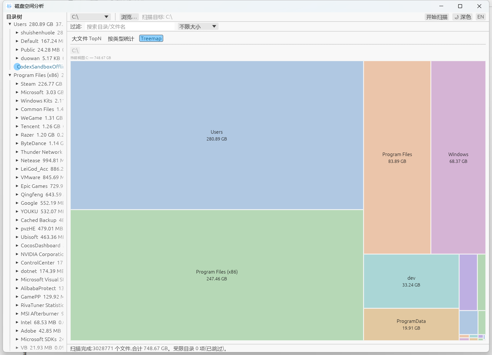

# 磁盘空间分析工具(storeanalyse)

一个 Windows 平台的磁盘空间分析桌面工具,定位类似 SpaceSniffer / WizTree:
并行扫描目录树,实时展示扫描进度,并以大文件列表、类型统计和 Treemap 矩形树三种视角帮你找出占空间的"元凶"。

## 功能特性

- **并行扫描**:基于 jwalk 的多线程目录遍历,大分区扫描速度显著优于单线程工具
- **边扫边看**:扫描过程中每秒推送部分快照,目录树 / 文件列表 / Treemap 实时展示已扫描内容,无需等待完成
- **暂停 / 继续**:扫描可随时暂停与恢复,暂停时耗时、速度等统计数字冻结不动
- **大文件 TopN**:按大小 / 名称排序,列头点击切换,支持 ↑↓ 光标 + 空格勾选
- **按类型统计**:按扩展名聚合大小与数量
- **Treemap 矩形树**:下钻式目录空间占比图,块形变 / 淡入过渡动画,悬停显示占比详情
- **联动导航**:点击目录树定位 Treemap;双击文件打开所在目录;Backspace 返回上一级
- **过滤**:搜索目录 / 文件名,支持大小阈值过滤
- **删除到回收站**:勾选文件经确认后移入回收站(trash),安全可恢复
- **深色 / 浅色主题**:一键切换,系统标题栏(DWM)跟随变色,偏好持久化保存
- **受限目录容错**:无权限的目录自动跳过并汇总列出,不会中断扫描

## 软件架构

```
src/
├── main.rs              程序入口,eframe 窗口初始化
├── app.rs               应用状态机(AppState)、面板编排、主题同步、联动导航
├── engine/
│   ├── scanner.rs       并行扫描引擎:jwalk 遍历、进度 Tick、每秒部分快照(Snapshot)、取消/暂停
│   ├── tree.rs          目录树数据结构(arena 索引、克隆快照、自底向上聚合)
│   └── treemap.rs       Squarify 矩形树布局算法
└── ui/
    ├── toolbar.rs       顶部工具栏:盘符选择、开始/取消/暂停、主题切换
    ├── status_bar.rs    底部状态栏:进度、速度、完成摘要
    ├── files_panel.rs   大文件列表(排序、多选、右键菜单、删除确认)
    ├── extension_panel.rs  扩展名统计面板
    ├── tree_panel.rs    左侧目录树面板
    └── treemap_panel.rs Treemap 面板(下钻、悬停、过渡动画)
```

分层原则:`engine/` 纯数据与算法(不依赖 egui),`ui/` 只渲染并上报动作,行为统一在 `app.rs` 执行。

## 技术栈

| 组件 | 用途 |
| --- | --- |
| [eframe / egui 0.36](https://github.com/emilk/egui) | 即时模式 GUI 框架 |
| [jwalk 0.9](https://crates.io/crates/jwalk) | 并行目录遍历 |
| [trash 5](https://crates.io/crates/trash) | 删除到回收站 |
| [rfd 0.17](https://crates.io/crates/rfd) | 原生文件夹选择对话框 |
| Windows DWM API | 系统标题栏深色/浅色跟随 |

## 构建与运行

环境要求:Windows 10 及以上,Rust 工具链(2024 edition,建议 1.85+)。

```bash
# 开发模式运行
cargo run

# 发布构建(产物在 target/release/analyse.exe)
cargo build --release

# 运行测试
cargo test
```

## 使用说明

主界面:左侧目录树 + 右侧三大面板(大文件 TopN / 按类型统计 / Treemap),下图为 Treemap 矩形树视图,色块面积即目录占用:



1. 顶部下拉选择盘符,或点击"浏览…"选择任意文件夹作为扫描目标
2. 点击"开始扫描",扫描期间即可切换三个 Tab 查看实时结果;可随时"暂停/继续"或"取消"
3. **大文件 TopN**:点击列头排序,↑↓ 移动光标,空格勾选;双击打开所在目录,右键复制路径 / 删除
4. **按类型统计**:查看各扩展名占用,辅助识别缓存 / 日志类文件
5. **Treemap**:左键色块下钻进入子目录,面包屑或 Backspace 返回,右键色块可删除对应目录(扫描完成后)
6. 过滤栏支持名称搜索与大小阈值,作用于文件列表与目录树
7. 勾选文件后按 Delete 或右键删除,会弹出确认框,文件移入回收站

## 已知限制

- 扫描不读取文件内容,超大分区首次扫描仍受磁盘随机读性能限制
- 权限受限目录(如其他用户 Profile)会被跳过并在状态栏列出
- Treemap 色块容量过大时(数万个子块)会限制绘制数量以保持流畅

## 许可

个人学习与内部使用。
